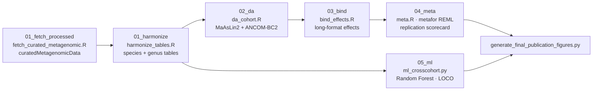

<div align="center">

# 🔬 IBD Taxonomic Dysbiosis — Cross-Cohort Reproducibility

**Do taxonomic dysbiosis signatures of inflammatory bowel disease (IBD) reproduce and transport across independent cohorts?**

A fully reproducible analysis pipeline that asks whether case–control taxonomic signatures discovered in one shotgun-metagenomic IBD cohort are **directionally consistent** (reproducible) and **predictive** (transportable) in other cohorts — at both **species** and **genus** resolution.

[](https://www.r-project.org/)
[](https://www.python.org/)
[](environment.yml)

**Table of contents**
[Overview](#-overview) · [Key results](#-key-results) · [Pipeline](#-pipeline) · [Repository layout](#-repository-layout) · [Reproducibility](#-reproducibility-contract) · [Quick start](#-quick-start) · [Outputs](#-outputs) · [Figures](#-figures) · [Cohorts](#-cohorts) · [Requirements](#-requirements) · [References](#-references)

</div>

---

## 🌍 Overview

Meta-analyses of gut-microbiome case–control studies repeatedly report *the same handful* of IBD-associated taxa — yet individual cohorts disagree on which taxa are altered and in which direction. This tension is usually blamed on technical heterogeneity (DNA extraction, sequencing platform, bioinformatic pipeline), but rarely tested explicitly.

This repository implements a **clean, reproducible test**: three independent shotgun-metagenomic IBD cohorts, harmonized through the same pipeline, analyzed with two independent differential-abundance methods, pooled by random-effects meta-analysis, and validated by cross-cohort predictive modelling.

The pipeline deliberately produces **fewer, better-supported claims**: a taxon survives only if its effect survives method concordance, FDR control, and majority sign-agreement across cohorts.

---

## 📊 Key results

| Metric | Result | How it's computed |
|---|---|---|
| **Species meta-analysed / replicated** | **195 tested → 27 replicated** | taxa present in ≥2 cohorts; FDR `p < 0.05` + ≥60% sign agreement |
| **Genera meta-analysed / replicated** | **89 tested → 15 replicated** | same criteria at genus level |
| **Transportability (genus)** | **mean LOCO AUC 0.746** | leave-one-cohort-out Random Forest, genus abundance |
| **DA method concordance** | required for any cohort signal | MaAsLin2 **and** ANCOM-BC2 agree on direction |
| **Cohorts** | 3 independent studies | Nielsen2014 · Ijaz2017 · HMP2 (MetaPhlAn3) |

> **Headline**: taxonomic dysbiosis signatures of IBD *do* reproduce across cohorts once the same analytical pipeline is applied — and genus-level taxonomic profiles carry a transportable predictive signal (mean cross-cohort AUC ≈ 0.75).

---

## 🔮 Pipeline



### Analysis rules

| Rule | Definition |
|---|---|
| **Concordance (stage 02)** | A taxon is a cohort signal only if MaAsLin2 and ANCOM-BC2 agree on sign and at least one passes a permissive threshold (`q_maaslin < 0.05` & `q_anc ≤ 0.1`, or vice versa) |
| **Replication (stage 04)** | Pooled effect is FDR-significant (`padj < 0.05`) **and** ≥60% of cohort estimates agree in sign (`n_agree ≥ ceil(0.6 · k)`) |
| **Transportability (stage 05)** | Random Forest trained per train→test cohort pair; features restricted to ≥20% prevalence in the *training* cohort only (no test-cohort leakage); `class_weight='balanced'`; AUC on held-out cohort |

---

## 📂 Repository layout

```
.
├── 00_setup/                 conda environment bootstrap (osx-64)
├── 01_fetch_processed/       curatedMetagenomicData fetch → MetaPhlAn3 tables + metadata
├── 01_fetch_upload/          (legacy) raw-read SRA download + upload scaffolding
├── 01_harmonize/             standardize lineages · dots, species = s__, genus = g__
├── 02_da/                    per-cohort DA: MaAsLin2 + ANCOM-BC2, concordance output
├── 03_bind/                  per-cohort effects → one long-format table
├── 04_meta/                  random-effects meta-analysis → replication scorecard
├── 05_ml/                    cross-cohort Random Forest validation (LOCO)
├── data/
│   ├── metadata/             sample_name / status / age / sex per cohort
│   └── taxon/                species & genus count tables (+ per-cohort subdirs)
├── figures/                  intermediate renders          (versioned)
├── figures_final/            publication figures 1–9       (versioned)
├── generate_*figures*.py     figure pipelines (final = publication versions)
├── environment.yml           full conda environment (R + Python)
├── cohorts.tsv               cohort provenance manifest (source PMIDs)
└── run_all.sh                single entry point for all stages
```

> `06_manuscript/`, `out/`, and `docx/` are build artifacts and excluded from version control (see `.gitignore`).

---

## ✅ Reproducibility contract

1. **Curated inputs, verifiable provenance.** Abundance tables and metadata are downloaded from `curatedMetagenomicData` (Bioconductor 3.18) and provenance is written into `cohorts.tsv`. PMIDs are read from `colData(PMID)` at fetch time and cross-checked against expectations — they are never hand-edited into the record (early hard-coded guesses pointed at unrelated papers).
2. **No silent mixing.** Each stage clears its own outputs before running, so a re-analysis cannot accumulate results from an older labelling scheme.
3. **Two methods or nothing.** No cohort-level claim rests on a single DA method.
4. **Deterministic ML.** Fixed `random_state=42`, and feature selection is confined to training data (test cohort never influences preprocessing).
5. **Fixed-format scorecards.** Replication results are emitted in a stable CSV schema (est / se / pval / padj / I² / k / n_agree / n_both / replicates).

---

## 🚀 Quick start

### 1. Environment

```bash
# miniforge/miniconda with mamba recommended
./00_setup/setup_env.sh          # creates 'pd-microbiome' from environment.yml
conda activate pd-microbiome
```

### 2. Fetch real data

```bash
./run_all.sh fetch
# Downloads MetaPhlAn3 abundance tables + curated metadata for 3 cohorts.
# Processed tables only — no raw reads are fetched or stored.
```

### 3. Run stages independently or end-to-end

```bash
./run_all.sh harmonize   # stage 1: standardize + build count tables
./run_all.sh analyze     # stages 2–3: DA per cohort → bind → meta-analysis
./run_all.sh ml          # stage 4: cross-cohort ML (LOCO)
./run_all.sh figures     # stage 5: publication figures 1–9
./run_all.sh all         # everything from a clean tree
```

Each stage deletes its own outputs first, so re-running any stage is always safe and reproducible.

---

## 📦 Outputs

| Artifact | Produced by | Notes |
|---|---|---|
| `out/replication_scorecard_species.csv` / `_genus.csv` | `04_meta/meta.R` | **Primary result** — pooled est., SE, p, FDR, I², k, sign agreement, replicated flag |
| `out/effects_long_species.csv` / `_genus.csv` | `03_bind/bind_effects.R` | Long-format per-cohort effects for pooling |
| `out/<level>/<cohort>/coefs.csv` | `02_da/da_cohort.R` | Per-cohort DA concordance (MaAsLin2 + ANCOM-BC2) |
| `out/ml_results/auc_results.txt` | `05_ml/ml_crosscohort.py` | All train→test AUCs |
| `out/ml_results/roc_auc_summary.csv` | figure pipeline | Aggregated LOCO AUC summary |
| `figures_final/figure_1..9_*.png` | figure pipeline | Publication figures (see below) |

---

## 📈 Figures

| Figure | Content |
|---|---|
| `figure_1_flowchart` | Study design: cohorts → pipeline → replication |
| `figure_2_forest_plot` | Pooled effect sizes per taxon (forest plot) |
| `figure_3_roc_curves` | ROC curves for every train→test cohort pair |
| `figure_4_composition` | Per-cohort taxonomic composition of replicated taxa |
| `figure_5_pcoa` | PCA of relative-abundance profiles across cohorts (PC1/PC2, status + cohort coloured) |
| `figure_6_heatmap` | Abundance / effect heatmap across cohorts |
| `figure_7_diversity` | Alpha diversity (Shannon, natural log) per cohort |
| `figure_8_importance` | Random-Forest feature importance for the pooled-frame model |
| `figure_9_network` | Co-occurrence networks (Spearman on relative abundance) per cohort |

---

## 🧬 Cohorts

| Cohort | Source study | PMID(s) | Design | Controls |
|---|---|---|---|---|
| `Nielsen2014` | Nielsen HB, *Nat Biotechnol* 2014 | [24997787](https://pubmed.ncbi.nlm.nih.gov/24997787/) | IBD vs healthy, cross-sectional | unrelated healthy |
| `Ijaz2017` | Ijaz UZ, *PLoS One* 2017 | [28222161](https://pubmed.ncbi.nlm.nih.gov/28222161/) | Crohn's disease, cross-sectional | unaffected genetically-linked kindred |
| `HMP2` | Schirmer *et al.* 2018 / Lloyd-Price *et al.* 2019 | [29311644](https://pubmed.ncbi.nlm.nih.gov/29311644/), [31142855](https://pubmed.ncbi.nlm.nih.gov/31142855/) | IBD multi-omics, baseline visit only | non-IBD |

---

## 🧰 Requirements

**R (4.3+):** `tidyverse`, `phyloseq`, `metafor`, `Maaslin2`, `ANCOMBC`, `curatedMetagenomicData` (Bioconductor 3.18), `SummarizedExperiment`

**Python (3.11+):** `pandas`, `numpy`, `scikit-learn`, `matplotlib`, `networkx`

All versions pinned in [`environment.yml`](environment.yml).

---

## 📚 References

- Nielsen HB *et al.* **Identification and assembly of genomes and genetic elements in complex metagenomic samples without using reference genomes.** *Nature Biotechnology*, 2014. [PMID 24997787](https://pubmed.ncbi.nlm.nih.gov/24997787/)
- Ijaz UZ *et al.* **Analysis of the gut microbiome in two geographically separated Crohn's disease cohorts.** *PLoS ONE*, 2017. [PMID 28222161](https://pubmed.ncbi.nlm.nih.gov/28222161/)
- Lloyd-Price J *et al.* **Multi-omics of the gut microbial ecosystem in inflammatory bowel diseases.** *Nature*, 2019. [PMID 31142855](https://pubmed.ncbi.nlm.nih.gov/31142855/)
- Mallick H *et al.* **Multivariable association discovery in population-scale meta-omics studies.** *PLoS Computational Biology*, 2021 (MaAsLin2).
- Lin H & Peddada SD. **Analysis of compositions of microbiomes with bias correction.** *Nature Communications*, 2020 (ANCOM-BC2).
- Viechtbauer W. **Conducting meta-analyses in R with the metafor package.** *Journal of Statistical Software*, 2010.

---

## ⚖️ License

Analysis code in this repository is provided for transparency and reproducibility. Input data remain the property of the respective cohort studies and are redistributed by `curatedMetagenomicData` under its own terms — consult the linked study licenses before any broader redistribution.