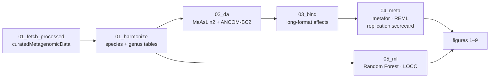
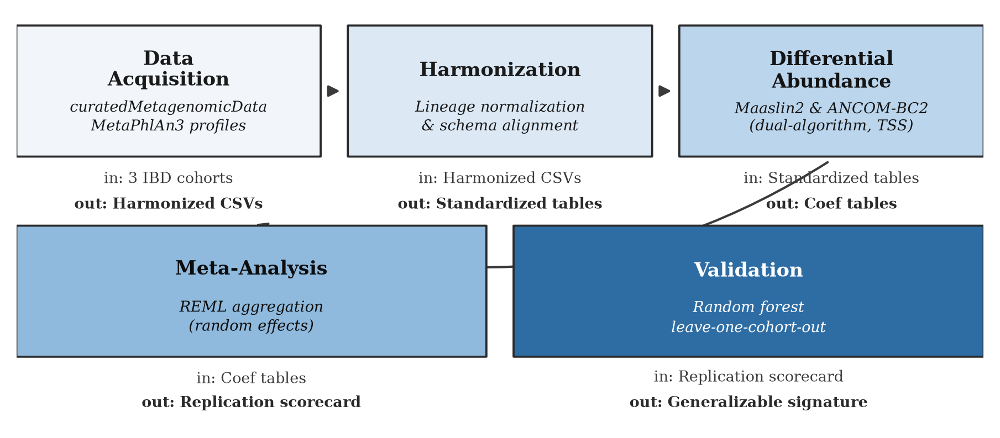
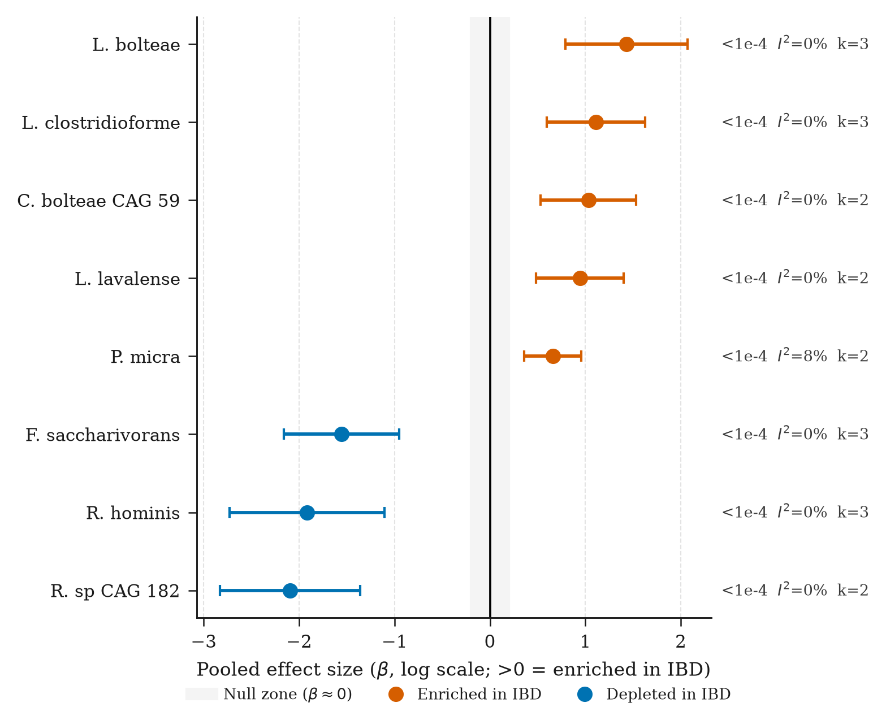
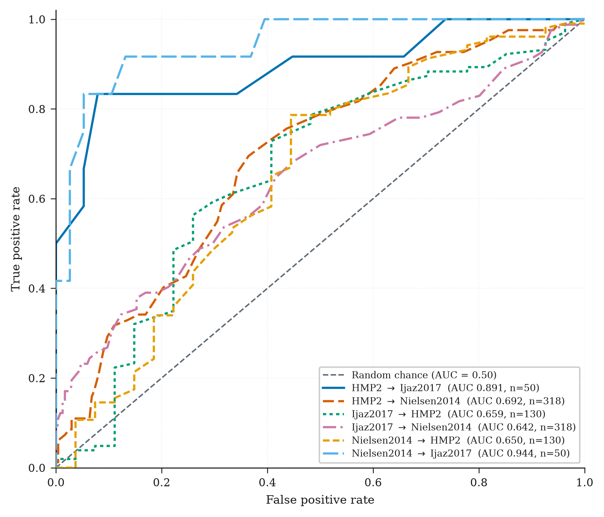
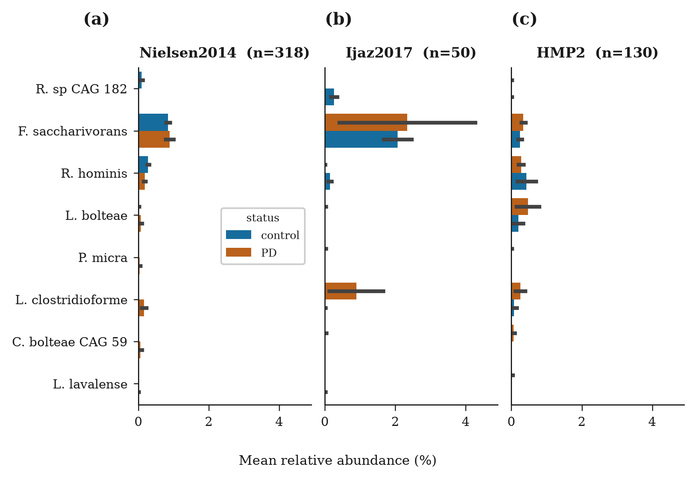
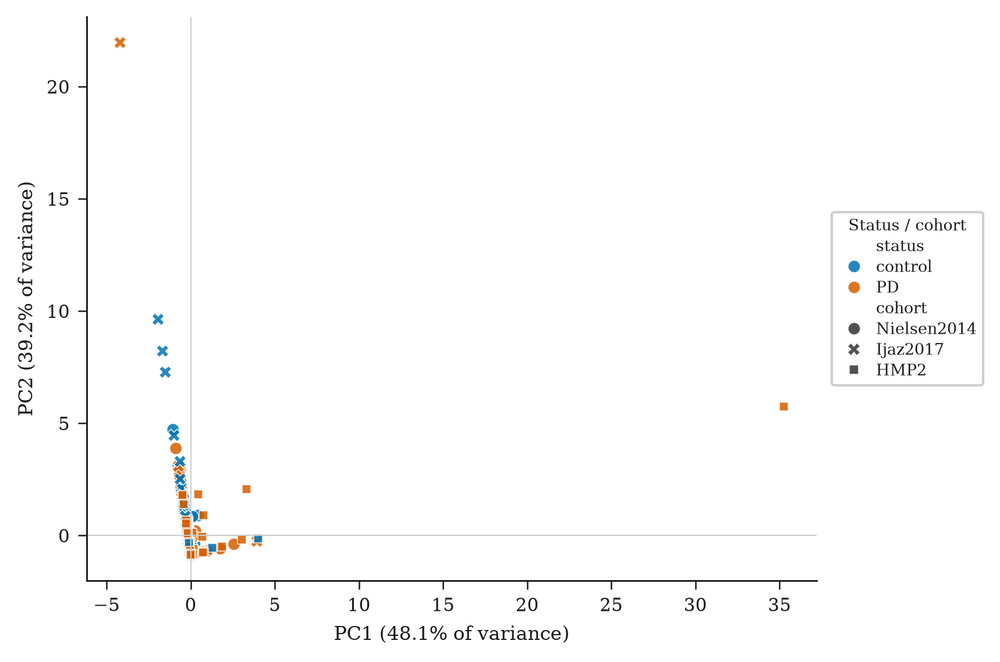
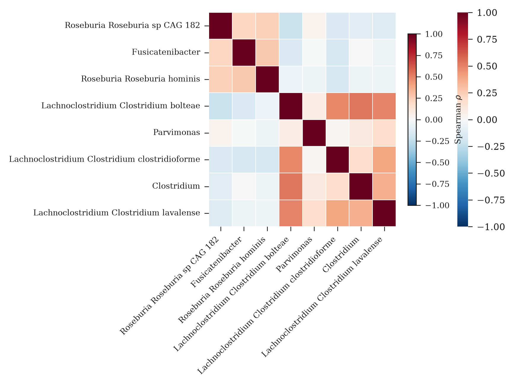
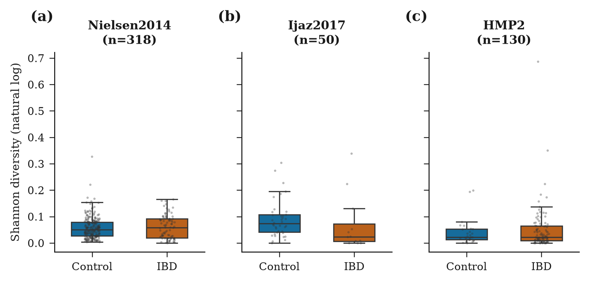
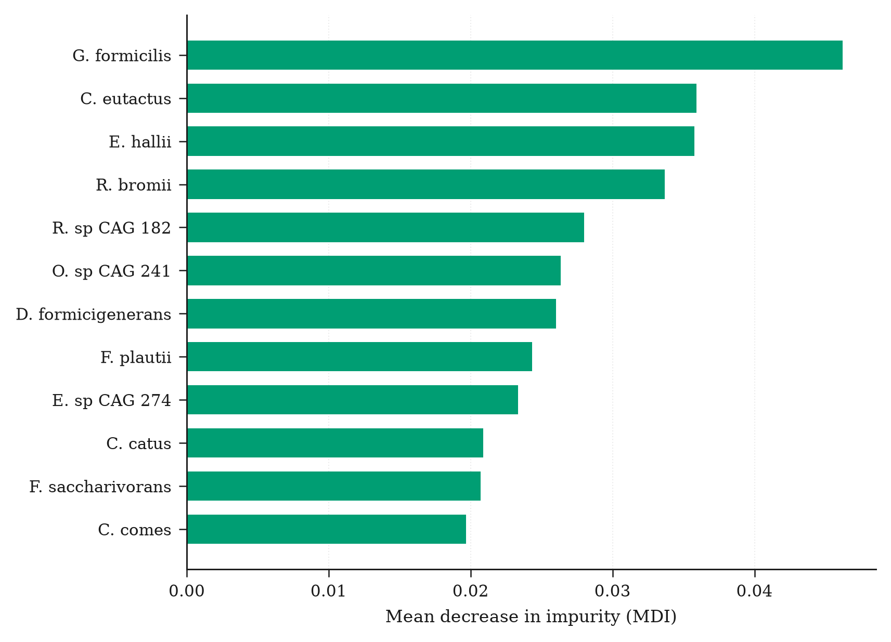
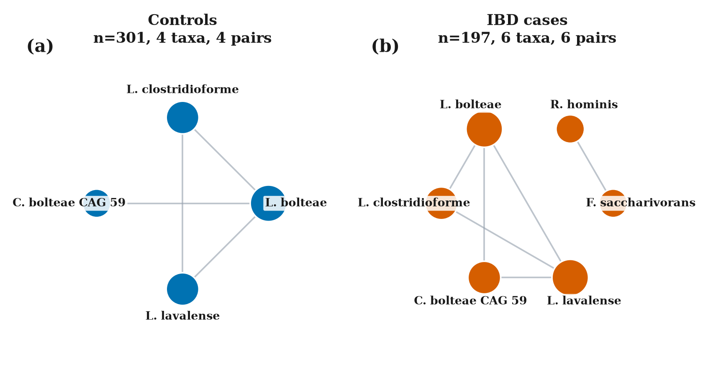

<div align="center">

# 🔬 IBD Taxonomic Dysbiosis

### Cross-Cohort Reproducibility & Transportability

**Do taxonomic dysbiosis signatures of inflammatory bowel disease (IBD) reproduce and transport across independent cohorts?**

A fully reproducible analysis pipeline for shotgun-metagenomic IBD cohorts:
**directionally consistent** (reproducible) and **predictive** (transportable) taxonomic signatures,
tested at both **species** and **genus** resolution.

<br>

[](https://www.r-project.org/)
[](https://www.python.org/)
[](environment.yml)
[](https://bioconductor.org/packages/release/data/experiment/html/curatedMetagenomicData.html)

<br>

| **27** replicated species | **15** replicated genera | **0.746** mean LOCO AUC | **3** cohorts |
|:---:|:---:|:---:|:---:|
| of 195 meta-analysed | of 89 meta-analysed | genus-level transportability | Nielsen2014 · Ijaz2017 · HMP2 |

</div>

---

## ✨ Highlights

- 📡 **Real shotgun-metagenomic data.** Three independent IBD cohorts from [`curatedMetagenomicData`](https://bioconductor.org/packages/release/data/experiment/html/curatedMetagenomicData.html) (MetaPhlAn3 profiles). Processed tables only — no raw reads fetched or stored.
- 🧪 **Two independent DA methods per cohort.** [MaAsLin2](https://github.com/biobakery/Maaslin2) and [ANCOM-BC2](https://github.com/FrederickHuangLin/ANCOMBC) must agree on effect direction for any cohort-level signal.
- 🧮 **Random-effects meta-analysis.** `metafor::rma` (REML) across cohorts, Benjamini–Hochberg FDR control, majority sign-agreement rule → replication scorecard.
- 🤖 **Cross-cohort transportability.** Leave-one-cohort-out Random Forest on genus abundance — **mean AUC 0.746**.
- ♻️ **Reproducibility by construction.** Single `run_all.sh` entry point, fixed seeds, curated provenance, stable scorecard schema, no silent output mixing.

---

## 🔮 Pipeline



### Analysis rules

| Rule | Definition |
|---|---|
| **Concordance** (stage 02) | MaAsLin2 & ANCOM-BC2 agree on sign; one passes `q < 0.05`, the other `q ≤ 0.1` (or vice versa) |
| **Replication** (stage 04) | pooled effect FDR-significant (`padj < 0.05`) **and** ≥60% of cohorts agree in sign |
| **Transportability** (stage 05) | per train→test pair Random Forest; features ≥20% prevalence in *training* cohort only (no leakage); `class_weight='balanced'`; AUC on held-out cohort |

---

## 📁 Repository layout

```
.
├── 00_setup/                 conda environment bootstrap
├── 01_fetch_processed/       curatedMetagenomicData fetch → abundance tables + metadata
├── 01_fetch_upload/          (legacy) raw-read SRA download scaffolding
├── 01_harmonize/             standardize lineages · species s__ / genus g__
├── 02_da/                    per-cohort DA: MaAsLin2 + ANCOM-BC2
├── 03_bind/                  per-cohort effects → long-format table
├── 04_meta/                  random-effects meta-analysis → replication scorecard
├── 05_ml/                    cross-cohort Random Forest transportability (LOCO)
├── data/
│   ├── metadata/             sample_name / status / age / sex per cohort
│   └── taxon/                species & genus count tables (+ per-cohort subdirs)
├── figures_final/            embedded previews of publication figures 1–9
├── environment.yml           pinned conda environment (R + Python)
├── cohorts.tsv               cohort provenance manifest (source PMIDs)
├── generate_final_publication_figures.py
└── run_all.sh                single entry point for all stages
```

> `06_manuscript/`, `out/`, and `docx/` are build artifacts, excluded from version control (see `.gitignore`).

---

## 📊 Key results

| Metric | Result | Detail |
|---|---|---|
| **Species replicated** | **27 / 195** meta-analysed | FDR `p < 0.05` + ≥60% sign agreement |
| **Genera replicated** | **15 / 89** meta-analysed | same criteria at genus level |
| **Transportability** | **mean LOCO AUC 0.746** | leave-one-cohort-out Random Forest, genus abundance |
| **DA concordance** | required for every cohort signal | MaAsLin2 **and** ANCOM-BC2 agree on direction |
| **Cohorts** | 3 independent | Nielsen2014 · Ijaz2017 · HMP2 (MetaPhlAn3) |

> **Headline** — Taxonomic dysbiosis signatures of IBD *do* reproduce across independent cohorts once a shared analytical pipeline is applied, and genus-level profiles carry a transportable predictive signal (**mean LOCO AUC ≈ 0.75**).

### Sample scorecard rows

Full qualified lineages are emitted; a shortened view of the species scorecard:

```
species                          est       se       pval       I2      k   n_agree  replicates
Roseburia sp CAG 182            -2.09     0.374    2.17e-08    0.0     2      2        True
Fusicatenibacter saccharivorans -1.56     0.308    4.56e-07    0.0     3      3        True
Roseburia hominis               -1.92     0.414    3.65e-06    0.0     3      3        True
```

---

## 🚀 Quick start

### 1 · Create the environment

```bash
./00_setup/setup_env.sh            # creates 'pd-microbiome' from environment.yml
conda activate pd-microbiome
```

### 2 · Fetch the real data

```bash
./run_all.sh fetch
# Downloads MetaPhlAn3 abundance tables + curated metadata for all 3 cohorts.
# Processed tables only — no raw reads are fetched or stored.
```

### 3 · Run stages independently — or end-to-end

```bash
./run_all.sh harmonize    # stage 1: standardize + build count tables
./run_all.sh analyze      # stages 2–3: DA per cohort → bind → meta-analysis
./run_all.sh ml           # stage 4: cross-cohort ML (LOCO)
./run_all.sh figures      # stage 5: publication figures 1–9
```

<details>
<summary><b>Run everything from a clean tree</b> (<code>./run_all.sh all</code>)</summary>

```bash
./run_all.sh all
# harmonize → analyze → ml → figures → manuscript → docx
```
</details>

Each stage clears its own outputs first, so re-running any stage is always safe and reproducible.

---

## 📈 Figures

<sup>Previews embed the files produced by the final figure pipeline.</sup>

| | | |
|:---:|:---:|:---:|
| **Fig 1 · Study design**<br> | **Fig 2 · Forest plot**<br> | **Fig 3 · ROC curves**<br> |
| **Fig 4 · Composition**<br> | **Fig 5 · PCA**<br> | **Fig 6 · Heatmap**<br> |
| **Fig 7 · Diversity**<br> | **Fig 8 · Feature importance**<br> | **Fig 9 · Co-occurrence**<br> |

---

## 📦 Outputs

| Artifact | Produced by | Notes |
|---|---|---|
| `out/replication_scorecard_species.csv` / `_genus.csv` | `04_meta/meta.R` | **Primary result** — est, se, pval, padj, I², k, n_agree, n_both, replicates |
| `out/effects_long_species.csv` / `_genus.csv` | `03_bind/bind_effects.R` | long-format per-cohort effects |
| `out/<level>/<cohort>/coefs.csv` | `02_da/da_cohort.R` | per-cohort DA concordance |
| `out/ml_results/auc_results.txt` | `05_ml/ml_crosscohort.py` | all train→test AUCs |
| `out/ml_results/roc_auc_summary.csv` | figure pipeline | aggregated LOCO AUC summary |

---

## ✅ Reproducibility contract

1. **Curated inputs, verifiable provenance.** Data from `curatedMetagenomicData` (Bioconductor 3.18); PMIDs are read from `colData(PMID)` at fetch time and cross-checked against `cohorts.tsv` — never hand-edited into the record.
2. **No silent mixing.** Each stage clears its own outputs before running.
3. **Two methods or nothing.** No cohort-level claim rests on a single DA method.
4. **Deterministic ML.** `random_state=42`; feature selection confined to training data.
5. **Fixed scorecard schema.** `est / se / pval / padj / I² / k / n_agree / n_both / replicates`.

---

## 🧬 Cohorts

| Cohort | Source study | PMID | Design | Controls |
|---|---|---|---|---|
| `Nielsen2014` | Nielsen HB, *Nat Biotechnol* 2014 | [24997787](https://pubmed.ncbi.nlm.nih.gov/24997787/) | IBD vs healthy, cross-sectional | unrelated healthy |
| `Ijaz2017` | Ijaz UZ, *PLoS One* 2017 | [28222161](https://pubmed.ncbi.nlm.nih.gov/28222161/) | Crohn's disease, cross-sectional | unaffected genetically-linked kindred |
| `HMP2` | Schirmer *et al.* 2018 / Lloyd-Price *et al.* 2019 | [29311644](https://pubmed.ncbi.nlm.nih.gov/29311644/), [31142855](https://pubmed.ncbi.nlm.nih.gov/31142855/) | IBD multi-omics, baseline visit only | non-IBD |

---

## 🧰 Requirements

| Stack | Packages |
|---|---|
| **R (4.3+)** | `tidyverse` · `phyloseq` · `metafor` · `Maaslin2` · `ANCOMBC` · `curatedMetagenomicData` (3.18) · `SummarizedExperiment` |
| **Python (3.11+)** | `pandas` · `numpy` · `scikit-learn` · `matplotlib` · `networkx` |

All versions are pinned in [`environment.yml`](environment.yml).

---

## 📚 References

- Nielsen HB et al. **Identification and assembly of genomes and genetic elements in complex metagenomic samples without using reference genomes.** *Nature Biotechnology*, 2014. [PMID 24997787](https://pubmed.ncbi.nlm.nih.gov/24997787/)
- Ijaz UZ et al. **Analysis of the gut microbiome in two geographically separated Crohn's disease cohorts.** *PLoS ONE*, 2017. [PMID 28222161](https://pubmed.ncbi.nlm.nih.gov/28222161/)
- Lloyd-Price J et al. **Multi-omics of the gut microbial ecosystem in inflammatory bowel diseases.** *Nature*, 2019. [PMID 31142855](https://pubmed.ncbi.nlm.nih.gov/31142855/)
- Mallick H et al. **Multivariable association discovery in population-scale meta-omics studies.** *PLoS Computational Biology*, 2021 (MaAsLin2).
- Lin H & Peddada SD. **Analysis of compositions of microbiomes with bias correction.** *Nature Communications*, 2020 (ANCOM-BC2).
- Viechtbauer W. **Conducting meta-analyses in R with the metafor package.** *Journal of Statistical Software*, 2010.

---

<div align="center">

**Built for transparency.** Code is provided for reproducibility of the analysis; input data remain the property of the respective cohort studies and are redistributed by `curatedMetagenomicData` under its own terms.

</div>